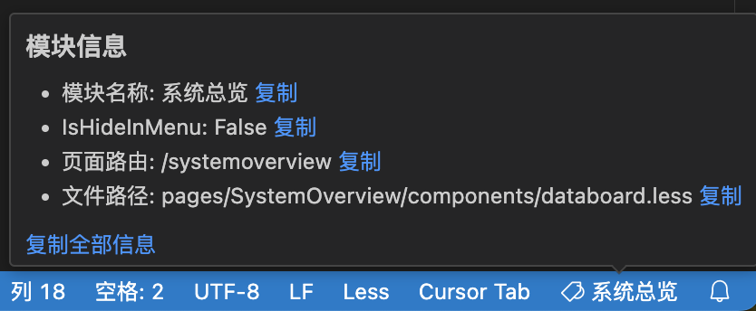

### version 0.2.42

### 功能

- 🎯 **精准路由解析**: 使用 AST 解析替代正则表达式，提供更准确的路由配置解析
- 📁 **智能文件映射**: 优化的文件路径映射逻辑，支持复杂目录结构与多路由共享模块
- 🔗 **依赖图传播**: 基于实际 import 关系精确推断文件所属路由，同步 title、access、路由路径等全部字段
- 🔍 **组件依赖分析**: 完善的组件依赖关系分析，支持别名路径解析
- ⚡ **性能优化**: 智能缓存机制，显著提升大型项目的解析速度
- 📊 **完善日志**: 分级日志系统，便于调试和问题排查
- 🔄 **热更新**: 支持文件变化时的增量更新，跨平台文件监听
- 🛠️ **错误处理**: 增强的错误处理机制，提高插件稳定性

### 主要改进

#### v0.2.4 优化
- ✅ **路由模块名解析重构**：修复 `extractModuleName` 路径截取错误，始终取第一级模块目录，避免遗漏公共文件
- ✅ **访问记录重置 bug 修复**：重新分析时已访问目录集合未清空，导致子目录被永久跳过，改为 Set 复合键并在每次构建时重置
- ✅ **模块名祖先查找优化**：新增 `findModuleNamesForDir` 向上递归查找，替代只查直接父目录的逻辑
- ✅ **路由精确匹配 bug 修复**：重写 `findMatchingRoute`，修复 `component` 含显式 `index` 时匹配失败的问题，统一处理 `@/`、`./` 等路径前缀
- ✅ **Windows 文件监听修复**：glob pattern 改为固定 `/`，修复 Windows 下文件变化监听失效
- ✨ **依赖图传播**：以直接路由匹配文件为种子，沿 import 方向 BFS，按跳数优先级为每个文件分配最相关的路由模块名（最多 3 个），同步更新 `title`、`access`、`routePath`、`hideInMenu` 等全部路由字段

#### v0.2.0 新特性
- ✨ **AST解析器**: 使用 Babel AST 解析路由配置，替代不可靠的正则表达式
- 🚀 **缓存系统**: 实现 LRU 缓存机制，支持文件校验和验证
- 📝 **日志系统**: 分级日志记录，支持调试模式
- 🔧 **重构架构**: 模块化设计，更好的可维护性
- 🎨 **类型安全**: 完善的 TypeScript 类型定义

### 配置字段

| 配置项 | 说明 | 默认值 |
|--------|------|--------|
| `extensionmodulemap.moduleSourceMapPath` | 需要解析的模块路径 | `./src/pages` |
| `extensionmodulemap.routeConfigPath` | 需要解析的路由文件 | `./config/routes.ts` |
| `extensionmodulemap.logLevel` | 日志级别（`debug` / `info` / `warn` / `error`） | `info` |
| `extensionmodulemap.enableCache` | 是否启用缓存 | `true` |
| `extensionmodulemap.cacheMaxAge` | 缓存最大存活时间（毫秒） | `300000`（5 分钟） |

### 使用方法

1. 安装插件后，插件会自动分析项目中的路由配置
2. 打开任意页面组件文件，右下角状态栏会显示模块信息
3. 点击状态栏图标可查看详细信息并复制相关内容
4. 右键菜单选择"重新分析模块映射"可手动刷新分析结果

### 效果

### 故障排除

如果插件无法正常工作，请检查：

1. 确保项目根目录存在路由配置文件（默认为 `./config/routes.ts`）
2. 确保页面组件目录存在（默认为 `./src/pages`）
3. 检查 VSCode 输出面板中的"UmiJS Router Module Analyzer"日志
4. 尝试右键选择"重新分析模块映射"

### 性能说明

- 插件使用智能缓存机制，首次分析后后续操作会更快
- 支持增量更新，只在文件变化时重新分析
- 依赖图传播基于实际 import 关系，比目录猜测更精确，大型项目也能获得准确的模块归属
- 大型项目建议适当调整缓存配置以获得最佳性能
